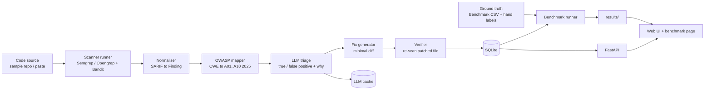

# PLAN.md: OWASP Sentinel

Hybrid LLM + SAST scanner for OWASP Top 10 (2025), benchmarked on known-vulnerable code.
Budget: 7 weeks of evenings and weekends, free compute (Colab/Kaggle), free hosting.

## Scope

| Area | In scope |
|---|---|
| Core languages | **Java** (OWASP Benchmark), **JavaScript/TypeScript** (OWASP Juice Shop) |
| Optional | PHP (DVWA), only if weeks 1–5 finish on time |
| Python | Test fixtures only (small hand-written vulnerable files), no benchmark claims |
| Features | Multi-language scanning, LLM triage of Semgrep findings, auto-fix verified by re-scan, benchmark page |
| Out of scope | GitHub App and PR commenting, PostgreSQL, React |

## 1. Architecture



- **Scanner runner**: runs Semgrep or Opengrep (Java, JS/TS, PHP, Python) and Bandit (Python) as subprocesses with a pinned rule set. Output is SARIF, the standard JSON format for static analysis results.
- **Normaliser**: turns each tool's SARIF into one `Finding` record: file, lines, rule, CWE, snippet, tool.
- **OWASP mapper**: maps CWE to an OWASP Top 10 2025 category using OWASP's published CWE lists, kept in one auditable YAML file.
- **LLM triage**: sends each finding plus its surrounding code to an LLM and gets back structured JSON with a verdict, confidence and short explanation.
- **Fix generator**: for confirmed findings, asks the LLM for a minimal unified diff.
- **Verifier**: applies the diff to a temp copy and re-runs the same rule. A fix counts only if the finding disappears, no new findings appear, and the file still parses.
- **LLM cache**: stores each prompt/response by hash, so reruns are free and reproducible.
- **Benchmark runner**: compares findings with the ground truth and writes precision/recall tables and charts to `results/`.
- **FastAPI + UI**: scan a pasted snippet or a bundled sample, browse findings, view the benchmark page.

## 2. Repo structure

```
owasp-sentinel/
├── sentinel/
│   ├── scanners/        # semgrep.py, bandit.py, runner.py
│   ├── core/            # models.py (Finding), sarif.py, owasp_map.py, owasp_2025.yaml
│   ├── llm/             # client.py (provider interface), prompts/, triage.py, fix.py, cache.py
│   ├── verify/          # apply_patch.py, rescan.py
│   ├── bench/           # targets.py, sample.py, labels/, metrics.py, coverage.py, run_bench.py
│   └── api/             # main.py, routes/, db.py
├── rules/               # pinned rule set + any custom rules
├── targets/             # fetch script + pinned commits (no vendored source)
├── web/                 # light UI (FastAPI + HTMX/Jinja) and benchmark page
├── results/             # tables, charts, coverage matrix, sample IDs
├── notebooks/           # Colab notebook for open-model triage runs
├── tests/               # unit tests + fixtures per language (Python fixtures live here)
├── .github/workflows/   # ci.yml (tests only)
├── docker-compose.yml
├── pyproject.toml
└── README.md            # includes the rules-licence decision
```

## 3. Evaluation design

**Baseline (Semgrep alone):** runs on the **full OWASP Benchmark** (~2,740 Java test cases) and is scored against the official expected-results CSV. This is cheap because no LLM is involved.

**Semgrep + LLM triage:** runs on a **stratified sample of ~450 Benchmark cases**.
- Stratify by the Benchmark's 11 test categories (about 40 each), balanced between real and fake vulnerabilities in each category.
- Fix the seed and save the sample IDs to `results/sample_ids.csv`.
- Also score the baseline on the same 450 cases so the comparison is like for like.
- Run triage 3 times per model and report mean and spread.

**Juice Shop (JavaScript):** a small hand-labelled set (~50–100 findings), checked against the documented challenge list. Report it separately as "small, hand-labelled" and don't merge it into the Benchmark numbers.

**Auto-fix:** fix success rate (verified by re-scan) on the confirmed true positives in the sample.

**Coverage on the benchmark page:** a matrix of all ten OWASP Top 10 2025 categories, each marked as:
- **Measured**: has ground-truth labels, so precision/recall are shown (with the label source and the number of cases), or
- **Not covered**: no ground truth, so no metrics are claimed. This is listed, not hidden.

Expected starting point (confirm against OWASP's 2025 CWE mapping in week 1): the Benchmark covers Injection (SQLi, command, LDAP, XPath, XSS), Cryptographic Failures (weak crypto, hashing, randomness), Broken Access Control (path traversal), plus cookie and trust-boundary cases. Juice Shop may add partial coverage for other categories. Categories like Software Supply Chain Failures and Security Logging & Alerting Failures will probably show "Not covered".

## 4. Week-by-week

| Week | Goal | Done when |
|---|---|---|
| 1 | Harness + rules decision | Read the Semgrep Rules License, choose **Registry rules** or **Opengrep + community rules**, record the decision in the README. Benchmark and Juice Shop fetched at pinned commits. Scanner runner, SARIF normaliser and CWE→OWASP 2025 map working, with tests on Java/JS/Python fixtures. |
| 2 | Ground truth + baseline | Benchmark answer key loaded. Full-Benchmark baseline table. 450-case stratified sample saved. Coverage matrix v1. Juice Shop labelling started. |
| 3 | LLM triage v1 | Provider interface, structured prompt, cache, one API model. First "with triage" numbers on the sample. |
| 4 | LLM triage v2 | Better code context, second (open) model on Colab, 3 runs each, variance reported. Juice Shop labels done and scored. |
| 5 | Auto-fix + verify | Diffs generated and verified by re-scan. Fix success rate measured. *(PHP/DVWA only if ahead of schedule.)* |
| 6 | API + UI | FastAPI, light UI, benchmark page with metrics and coverage matrix, charts in `results/`. |
| 7 | Ship + buffer | Deploy demo, benchmark report, write-up. No new features. |

## 5. Risks and first checks

1. **Ground truth**: precise labels exist only for the OWASP Benchmark, and only for some OWASP categories. Mitigation: Benchmark is the main scored set, Juice Shop is a small labelled set reported separately, and the coverage matrix shows the gaps.
2. **Licences**: the Semgrep Registry rules restrict use in hosted services (week 1 decision above). WebGoat, DVWA and OWASP Benchmark are GPL and Juice Shop is MIT, so fetch them at pinned commits and never copy their source into the repo.
3. **LLM compute/cost**: the 450-case sample × 2 models × 3 runs comes to ~2,700 triage calls, plus fix calls. Mitigation: cache everything, use a free-tier API while building, run a quantised open code model (e.g. Qwen2.5-Coder 7B) on Colab/Kaggle, and have the demo show precomputed results plus small rate-limited live scans.
4. **Demo safety**: the demo accepts user code, so cap its size and never execute it (the scanners only read code). Keep API keys in deployment secrets.

## 6. Simplifications

- SQLite instead of PostgreSQL.
- FastAPI + HTMX/Jinja instead of React; the benchmark page renders from `results/`.
- One LLM provider interface with two models at most (one API, one open).
- Bandit only for Python fixtures; Semgrep/Opengrep is the main engine.
- No GitHub integration beyond CI.

## Concepts (plain language + one reading each)

- **SAST (static application security testing)**: finding bugs by reading code without running it. It's fast and broad, but noisy because it can't see runtime context. *Read:* the "Writing rules" tutorial in the Semgrep docs.
- **Precision vs recall**: precision asks "of what I flagged, how much was real?"; recall asks "of what was real, how much did I flag?". The aim of triage is to raise precision without losing much recall. *Read:* "Classification: precision and recall" in Google's ML Crash Course.
- **Stratified sampling**: picking a sample with the same mix of groups (here, categories and real/fake cases) so that no group dominates the results. *Read:* the scikit-learn user guide section on stratified splits (`StratifiedShuffleSplit`).
- **LLM-assisted triage**: using a language model as a second opinion on each alert, with structured output so the results can be measured. *Read:* Li et al. 2024, "IRIS: LLM-Assisted Static Analysis for Detecting Security Vulnerabilities" (arXiv).
- **OWASP Benchmark**: a Java test suite with known real and fake vulnerabilities, built for scoring scanners. *Read:* the OWASP Benchmark project page.
