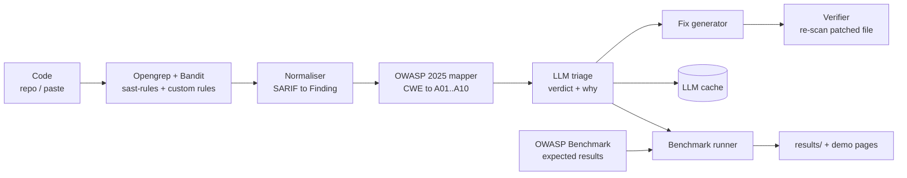

# OWASP Sentinel

**A hybrid scanner that finds OWASP Top 10 (2025) vulnerabilities with static analysis, then asks an LLM to cut the false positives, benchmarked against known answers.**

[Live demo (static)](https://ankomahaidoo-owasp-sentinel.static.hf.space/) ·
[Write-up](docs/WRITEUP.md) · [Plan](PLAN.md) ·
Built by Nathaniel Ankomah Aidoo ([portfolio](https://nathanielaidoo.me),
[LinkedIn](https://www.linkedin.com/in/nathaniel-ankomah-aidoo))

> **PRELIMINARY RESULTS.** LLM triage has been run **once** (run 1 of 3). The final
> three-run mean ± spread is pending (see [PROGRESS.md](PROGRESS.md)); cells marked
> `TBD` below are placeholders. Differences of a few points between B and C may be noise.

<!-- TODO: add demo GIF here (docs/demo.gif) once recorded -->
*Demo GIF: placeholder.*

## What it does

Scan Java, JavaScript or Python code with Opengrep and open rules, map each finding to
an OWASP Top 10 2025 category, let an LLM label each as true or false positive, and
(optionally) generate a fix that is only accepted if a re-scan confirms it. Scanners
only read code; nothing scanned is ever executed.

## Architecture



## Results (OWASP Benchmark for Java, 450-case stratified sample)

*Precision: how many flagged issues are real. Recall: how many real issues are found.
False-positive rate (FPR): how many safe samples are wrongly flagged.*

| Configuration | Precision | Recall | FPR |
|---|--:|--:|--:|
| A. Opengrep + GitLab sast-rules | 0.675 | 0.600 | 0.289 |
| B. A + custom Java rules | 0.676 | 0.889 | 0.427 |
| C. B + LLM triage, **preliminary (1 run)** | 0.712 | 0.889 | 0.360 |
| C. B + LLM triage, **final (3 runs, mean ± sd)** | TBD | TBD | TBD |

Triage model: `gemini-3.1-flash-lite`, temperature 0.3, 388 findings triaged per run.
Full-Benchmark baselines, per-category tables and the OWASP 2025 coverage matrix
(unmeasured categories are "Not covered") are in `results/` and on the
[benchmark page](https://ankomahaidoo-owasp-sentinel.static.hf.space/benchmark.html).

## How to run

See Quickstart and Running scans below. In short:

```powershell
pip install -e ".[dev]"; pytest
docker build --target demo -t sentinel-demo .
docker run --rm -p 7860:7860 sentinel-demo   # live scanner at http://localhost:7860
```

## Limitations

- Triage numbers are one run until runs 2 and 3 finish; no variance is known yet.
- One benchmark, one language (Java) is scored. Juice Shop (JavaScript) is not scored in
  the headline table; Python has fixtures only, no benchmark claims.
- The custom rules are broad: recall rises 0.600 to 0.889 but FPR rises 0.289 to 0.427.
- The LLM may have seen the public Benchmark in training, which could flatter C.
- The public demo is static; hosted live scanning needs a Docker host (not free on
  Hugging Face).
- Only 5 of the 10 OWASP 2025 categories have any ground truth; see the coverage matrix.

## Future work

Tune the custom rules to lower FPR; finish three triage runs and add charts; compare an
open-weights model against the hosted one; score Juice Shop with a small hand-labelled
set; test on contamination-free (newly written) vulnerable code.

## Quickstart (Windows, PowerShell)

```powershell
python -m venv .venv
.\.venv\Scripts\Activate.ps1
pip install -e ".[dev]"
pytest
uvicorn sentinel.api.main:app --reload   # http://localhost:8000/health
```

With Docker:

```powershell
copy .env.example .env
docker compose up --build
```

## Repo layout

See section 2 of [PLAN.md](PLAN.md). Benchmark targets are fetched into `targets/`
at pinned commits and are never committed.

## Benchmark data

Targets are fetched at pinned commits (`targets/commits.json`), never vendored.

| Dataset | Used for | Licence |
|---|---|---|
| OWASP BenchmarkJava | Java ground truth | GPL-2.0 (fetched, not copied) |
| OWASP Juice Shop | JavaScript ground truth | MIT (fetched, not copied) |

DVWA and WebGoat are out of scope and not fetched.

To run the full data check locally, including the reproducibility test that is
skipped in CI (it needs the fetched Benchmark checkout):

```powershell
python targets/fetch.py
pytest tests/test_bench_data.py
```

## Rules licence decision

**Decision: Opengrep engine + openly licensed rules only.** Rules are fetched at a
pinned commit into `targets/` (see `targets/commits.json`) and never copied into
this repo.

| Component | Source | Licence |
|---|---|---|
| Engine | [Opengrep](https://github.com/opengrep/opengrep) v1.31.0 (release binary, sha256-pinned in the Dockerfile) | LGPL-2.1 |
| Rules (Java, JS, Python) | GitLab [sast-rules](https://gitlab.com/gitlab-org/security-products/sast-rules) @ `53bf5cf6df` | MIT (repo LICENSE; `doc/` is CC BY-SA 4.0 and is not used) |
| Python scanner | [Bandit](https://github.com/PyCQA/bandit) | Apache-2.0 |

Rejected:
- **Semgrep Registry rules**: Semgrep Rules License restricts use in hosted services,
  and PLAN.md ships a public demo.
- **`opengrep/opengrep-rules`**: a mirror of semgrep-rules under LGPL-2.1 *plus the
  Commons Clause*, which forbids selling a service whose value comes from the
  software. That is not open-source, so it is excluded.

Licences were read from each repo's LICENSE file on 2026-10-15. This is not legal
advice. GitLab's rule set has no PHP rules, so PHP stays out of scope (PLAN.md
already makes it optional).

## Running scans (Docker, works on Windows)

No native Semgrep/Opengrep install is needed. Fetch targets and rules, then:

```powershell
python targets/fetch.py
docker compose --profile scan run --rm scanner /targets/juice-shop `
  --config /targets/sast-rules/javascript --config /targets/sast-rules/java `
  --out /out/scan_juice_shop.json
```

The scanner container mounts `targets/` read-only and only reads the code.

Full Benchmark scan, fast path (sources copied into a Docker volume, batches of 200
files, progress printed; ~5 min vs ~14 min reading the Windows folder directly):

```powershell
$env:MSYS_NO_PATHCONV=1   # Git Bash only
docker compose --profile scan run --rm seed-volume
docker compose --profile scan run --rm scanner-fast /work/benchmark/testcode `
  --config /work/sast-rules/java --batch-size 200 --out /out/scan_benchmark_full.json
python -m sentinel.bench.run_bench results/scan_benchmark_full.json
uvicorn sentinel.api.main:app   # then open http://localhost:8000/benchmark
```

## Development

```powershell
pre-commit install   # ruff + black on every commit
pytest
```

Coding rules are in [CLAUDE.md](CLAUDE.md).
